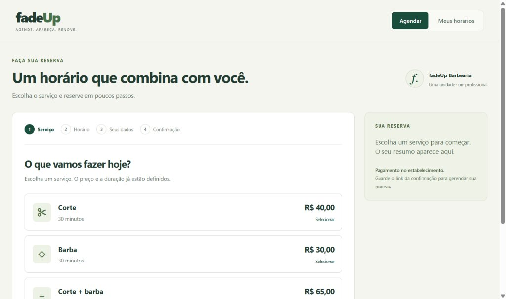
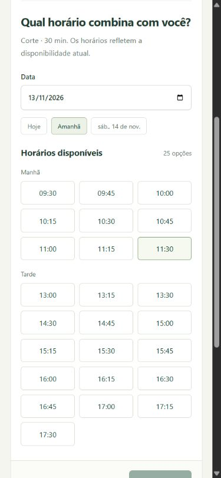
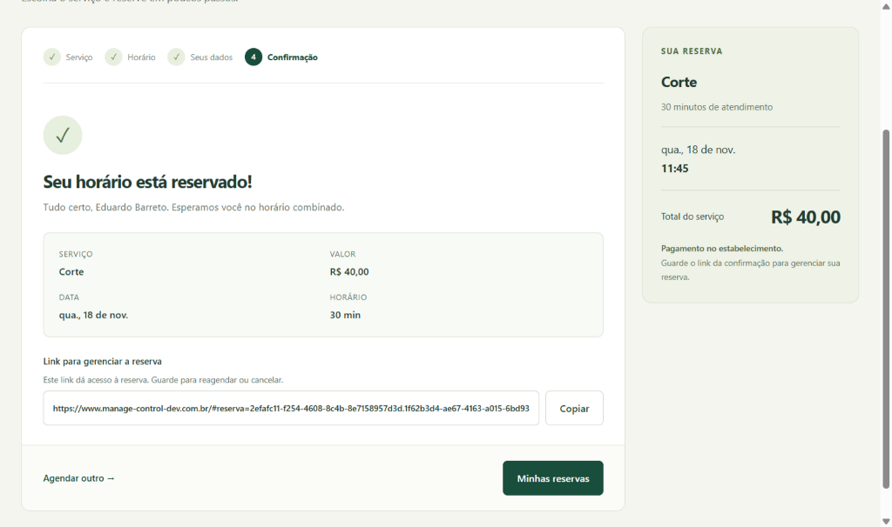
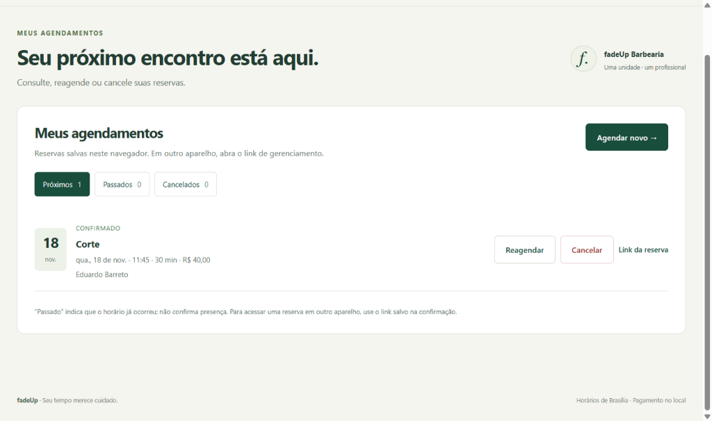
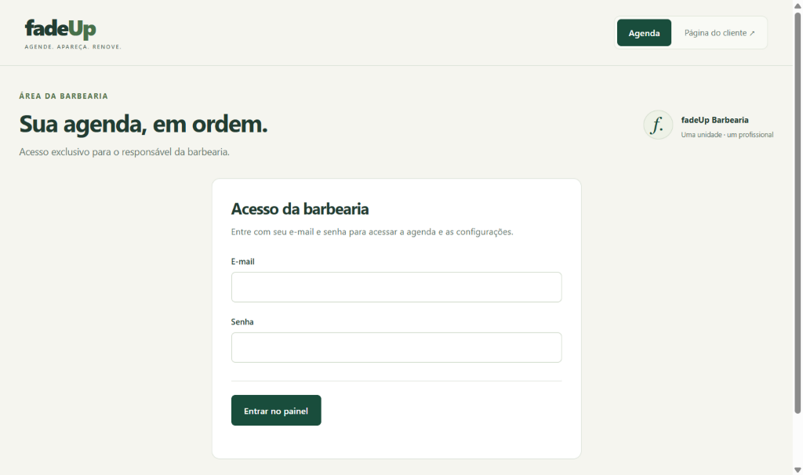
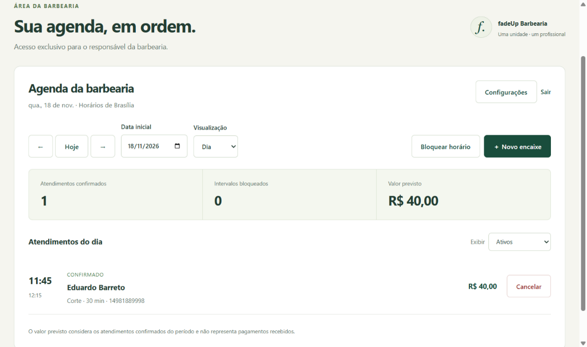
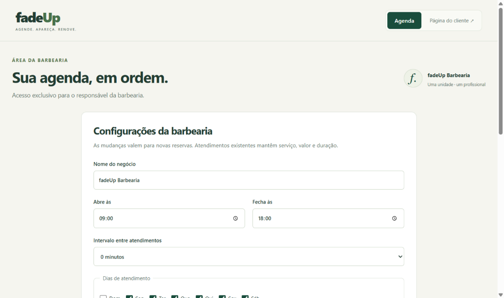
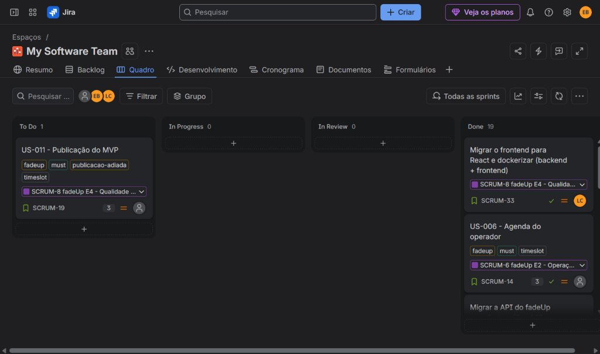
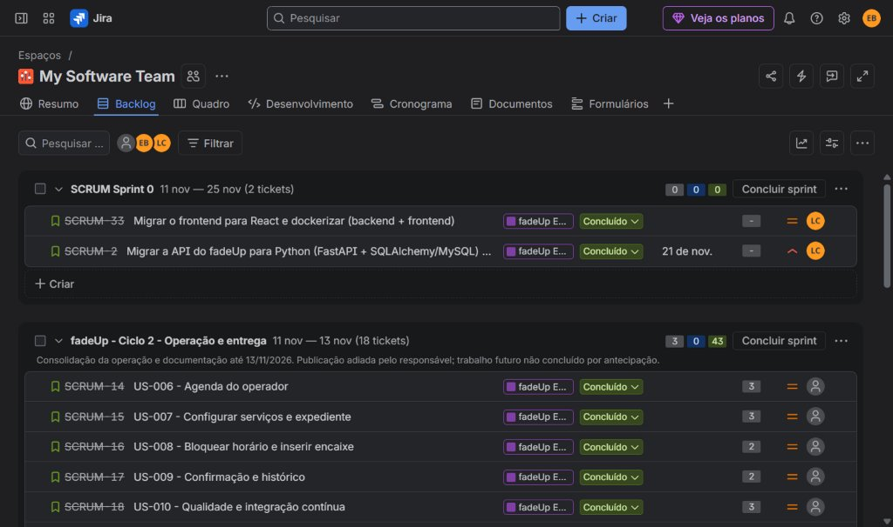

# fadeUp — Projeto Semestral TimeSlot

3.1 Capa | Engenharia de Software III | Análise e Desenvolvimento de Sistemas (ADS) — Fatec Garça

Squad fadeUp. Produto: sistema web de agendamento online para barbearia (uma unidade e um profissional), permitindo ao cliente reservar, consultar, reagendar e cancelar horários em até 4 etapas e ao administrador gerenciar agenda, bloqueios, encaixes e configurações com autenticação JWT em duas camadas.

| Integrante | Papel na Squad | Participação verificada no projeto |
| --- | --- | --- |

| Lucas Castilho | Product Owner (PO) | Definição do recorte do produto, migração completa da API para Python (FastAPI + Clean Architecture + MySQL + Alembic + JWT), reescrita do frontend em React/TypeScript, containerização Docker e publicação em produção na VPS (SCRUM-2, SCRUM-33 e commits c1136d2, 32d2cec, 674b20c). |

| Eduardo Zucco | Scrum Master (SM) | Condução do backlog e sprints no Jira, implementação inicial do MVP e 16 Pull Requests com testes automatizados, auditoria de concorrência, isolamento de áreas e documentação de evidências (SCRUM-5 a SCRUM-32). |

| Felipe Pereira | Integrante da squad | Integrante da equipe fadeUp participante do projeto semestral. |

| Fausto Iriu | Integrante da squad | Integrante da equipe fadeUp participante do projeto semestral. |

- **Aplicação em Produção (URL no ar)**: [https://www.manage-control-dev.com.br/](https://www.manage-control-dev.com.br/)

- **Painel Administrativo (Autenticado)**: [https://www.manage-control-dev.com.br/admin](https://www.manage-control-dev.com.br/admin)

- **Projeto Jira e Board (SCRUM / Board ID 1)**: [https://eduardobarreto879.atlassian.net/jira/software/projects/SCRUM/boards/1](https://eduardobarreto879.atlassian.net/jira/software/projects/SCRUM/boards/1)

- **Repositório GitHub (Público)**: [https://github.com/eduardo-zucco/fadeup-timeslot](https://github.com/eduardo-zucco/fadeup-timeslot)

Consolidação final deste documento: 17 de novembro de 2026, cobrindo todo o histórico executado entre 11 e 17 de novembro de 2026 (MVP inicial, auditoria e refinamentos, separação arquitetural, migração para Python/FastAPI + React/MySQL + Docker e publicação em HTTPS).

Acesso para avaliação: a aplicação pública está acessível sem login em https://www.manage-control-dev.com.br/ (a área /admin é protegida por login com e-mail e senha). O repositório GitHub (https://github.com/eduardo-zucco/fadeup-timeslot) está público para consulta de commits, Pull Requests e workflows; o board Jira (projeto SCRUM) permanece atualizado com todas as entregas.

## 3.2 Discovery

O cenário proposto pelo cliente descreve um pequeno negócio de bairro (barbearia) que realiza agendamentos exclusivamente via WhatsApp e caderno físico. As dores identificadas no briefing são: choque de horários, faltas de clientes por esquecimento, tempo operacional perdido respondendo mensagens repetitivas durante os atendimentos e ausência de histórico estruturado de reservas.

Recorte adotado: barbearia com uma unidade física e um profissional, preservando simplicidade máxima para que o cliente final conclua o agendamento pelo navegador do celular em até 4 etapas e o dono administre a agenda única sem depender de aplicativos complexos.

### Lean Canvas — Síntese e Descrição Completa dos Nove Blocos

| Bloco do Lean Canvas | Descrição detalhada em texto |
| --- | --- |

| 1. Problema | Agendamentos manuais por WhatsApp e caderno provocam demora na resposta, perda de clientes fora do horário comercial, risco constante de choque de horários e falta de visibilidade do histórico de atendimentos e cancelamentos. |

| 2. Segmentos de clientes | Primário (MVP): dono de barbearia de bairro (1 unidade, 1 profissional) e seus clientes finais que acessam links pelo navegador móvel ou desktop. Segmentos futuros possíveis citados no briefing (salões de beleza e petshops) permanecem como expansão posterior. |

| 3. Proposta única de valor | Autoatendimento direto em navegador sem necessidade de instalar aplicativo ou criar conta longa: o cliente escolhe serviço, data e horário realmente livre em 4 etapas e recebe um link exclusivo de gerenciamento; o dono centraliza a agenda em tempo real sem conflitos. |

| 4. Solução | Aplicação web responsiva (React + TypeScript) integrada a uma API REST em Python (FastAPI + MySQL): catálogo com preço e duração, cálculo de disponibilidade em blocos de 15 minutos no fuso America/Sao_Paulo, reserva transacional à prova de concorrência, chave secreta individual (X-Booking-Token) para consulta/reagendamento/cancelamento e painel administrativo (/admin) protegido por JWT em 2 camadas. |

| 5. Canais | Link direto publicado em https://www.manage-control-dev.com.br/ para compartilhamento na bio do Instagram, mensagens automáticas de saudação do WhatsApp Business ou QR Code impresso no balcão da barbearia. |

| 6. Fontes de receita | No escopo acadêmico do MVP não há cobrança nem processamento de pagamentos online (o pagamento pelo serviço ocorre presencialmente no estabelecimento). Como modelo futuro de negócio, prevê-se assinatura mensal acessível (SaaS) por barbearia. |

| 7. Estrutura de custos | Desenvolvimento pela squad, registro do domínio, hospedagem em VPS Linux (Hostinger) com Docker Compose + MySQL + certificado SSL gratuito Let's Encrypt. Nenhuma API paga de mensageria ou gateway foi contratada nesta etapa. |

| 8. Métricas-chave | Número de atendimentos confirmados, taxa de cancelamentos e reagendamentos pelo autoatendimento, conflitos de concorrência bloqueados (HTTP 409), previsão de faturamento no painel do operador e saúde da API (/healthy_check). |

| 9. Vantagem competitiva (Injusta) | Fluxo ultraenxuto sem fricção (sem senha para o cliente final, sem seleção obrigatória de múltiplos profissionais), garantia de consistência atômica direto no banco relacional MySQL e código modularizado em Clean Architecture com baixo custo operacional em VPS. |

### Personas Refinadas

| Persona | Quem é e contexto | Objetivos | Dores e necessidades |
| --- | --- | --- | --- |

| Marcos (Dono e Barbeiro, 38 anos) | Proprietário de barbearia de bairro com uma cadeira. Atende clientes presencialmente e administra tudo sozinho pelo celular e computador. | Organizar o dia com antecedência, evitar horários vazios inesperados e parar de interromper cortes para responder WhatsApp. | Sofre com reservas anotadas errado no caderno e clientes que perguntam horários disponíveis tarde da noite. Precisa de agenda por dia/semana, bloqueio rápido de pausas (ex.: almoço), encaixe manual e edição fácil de preços e expediente. |

| Ana (Cliente final, 27 anos) | Cliente habitual que agenda pelo celular no intervalo do trabalho ou à noite, sem paciência para baixar apps ou preencher formulários longos. | Ver preços e horários livres na hora e conseguir reagendar ou cancelar sozinha caso surja um imprevisto. | Desiste quando precisa esperar resposta humana no WhatsApp ou quando descobre o preço só depois de perguntar. Precisa saber valor e duração antes de confirmar, guardar um link simples da reserva e ver seu histórico no próprio navegador. |

## 3.3 MVP

O MVP foi estruturado a partir da jornada completa do cliente e do operador da barbearia, evoluindo em iterações até a versão em produção em https://www.manage-control-dev.com.br/. A menor funcionalidade demonstrável é o ciclo ponta a ponta de escolher serviço, reservar um horário livre sem risco de sobreposição e visualizá-lo imediatamente na agenda autenticada do administrador.

### Story Map — Atividades do Usuário e Histórias Mapeadas

| Atividade do Usuário | Histórias / Tarefas no Backlog | Entrega no MVP e Evoluções |
| --- | --- | --- |

| 1. Descobrir atendimento | US-001 (SCRUM-9) | Catálogo público com nome do serviço, preço em reais e duração em minutos. |

| 2. Escolher data e horário | US-002 (SCRUM-10), SCRUM-23 | Cálculo de slots em janelas de 15 min considerando expediente, dias úteis, intervalo, ocupação e fuso America/Sao_Paulo. |

| 3. Confirmar reserva | US-003 (SCRUM-11), US-014 (SCRUM-24), SCRUM-22 | Fluxo em 4 etapas com resumo lateral, rascunho preservado ao voltar, validação de nome/DDD/consentimento e proteção transacional contra dupla reserva. |

| 4. Consultar confirmação e histórico | US-009 (SCRUM-17), US-015 (SCRUM-25) | Confirmação na tela com link de gerenciamento; histórico salvo no navegador separado em Próximos, Passados e Cancelados. |

| 5. Gerenciar a reserva | US-004 (SCRUM-12), US-005 (SCRUM-13) | Reagendamento atômico preservando serviço/duração original e cancelamento liberando imediatamente os intervalos via X-Booking-Token. |

| 6. Administrar o negócio | US-006 (SCRUM-14), US-007 (SCRUM-15), US-008 (SCRUM-16), US-016 (SCRUM-26), US-017 (SCRUM-28) | Painel /admin isolado da área do cliente e protegido por login (e-mail + senha com JWT), visão dia/semana, filtros, bloqueios, encaixe manual e edição de catálogo/expediente. |

| 7. Qualidade, arquitetura e produção | US-010 (SCRUM-18), US-011 (SCRUM-19), US-012 (SCRUM-20), US-018 (SCRUM-2), US-019 (SCRUM-33), SCRUM-27..32 | Testes automatizados (35 pytest), CI/CD via GitHub Actions, Clean Architecture Python + MySQL + Alembic, React + Docker Compose e deploy HTTPS em produção. |

### Linha de Corte do MVP (O que entrou, o que ficou de fora e por quê)

- O que ENTROU no escopo entregue: todo o núcleo funcional do agendamento em 4 etapas (US-001 a US-005 e US-009), a operação completa da barbearia (US-006 a US-008), as melhorias de UX, concorrência e isolamento de rotas (US-014 a US-017 e tarefas SCRUM-22 a SCRUM-32), a migração definitiva para Clean Architecture em Python/FastAPI/MySQL + frontend React/TypeScript + Docker (US-018 / SCRUM-2 e US-019 / SCRUM-33) e a publicação com HTTPS em https://www.manage-control-dev.com.br/.

- O que FICOU DE FORA do MVP: envio ativo de mensagens pelo WhatsApp (US-013 / SCRUM-21 — prioridade Could), pagamento online/antecipado, múltiplos profissionais ou múltiplas unidades, chatbot de atendimento, fidelidade/cupons e aplicativo nativo iOS/Android.

- Por que ficou de fora: o objetivo central do MVP é validar o autoatendimento web sem intermediários em no máximo 4 passos. Integrar gateway de pagamento ou API oficial do WhatsApp adicionaria custos de mensageria, aprovação de templates e gestão de webhooks que não são necessários para comprovar a resolução do choque de horários; o sistema mantém a tabela outbox preparada para evolução futura sem prometer envio automático na interface.

### Fluxo do Cliente em Quatro Etapas e Parâmetros Padrão

- Etapa 1 — Serviço: o cliente visualiza o catálogo editável (padrão inicial: Corte R$ 40,00 / 30 min; Barba R$ 30,00 / 30 min; Corte + barba R$ 65,00 / 60 min).

- Etapa 2 — Horário: seleciona a data (hoje até +90 dias, padrão seg–sáb 09:00–18:00) e escolhe um horário livre agrupado em Manhã, Tarde ou Noite.

- Etapa 3 — Seus dados: informa nome, WhatsApp com DDD e marca o consentimento LGPD para contato/gestão.

- Etapa 4 — Confirmação: recebe a confirmação na tela e o link exclusivo (#reserva=<id>.<token>) salvo automaticamente no navegador para consultas, reagendamentos ou cancelamentos futuros.

## 3.4 Backlog no Jira

O projeto é gerenciado no Jira sob a chave SCRUM (Board ID 1), reunindo 4 épicos (SCRUM-5 a SCRUM-8), 26 histórias e tarefas concluídas do MVP (SCRUM-2, SCRUM-3, SCRUM-9 a SCRUM-20 e SCRUM-22 a SCRUM-33), 1 subtask técnica concluída (SCRUM-4, vinculada à SCRUM-2) e 1 história de evolução futura fora do MVP (SCRUM-21).

| Épico | Título no Jira | Descrição e Escopo | Status Jira |
| --- | --- | --- | --- |

| SCRUM-5 / E1 | fadeUp E1 - Agendamento do cliente | Catálogo de serviços, cálculo de disponibilidade, reserva sem conflito, cancelamento, reagendamento e consistência transacional. | Concluído |

| SCRUM-6 / E2 | fadeUp E2 - Operação da barbearia | Agenda diária e semanal do operador, configuração de serviços/expediente, bloqueios, encaixes manuais e isolamento autenticado de /admin. | Concluído |

| SCRUM-7 / E3 | fadeUp E3 - Comunicação | Confirmação em tela, histórico no navegador com separação de abas e preparação futura de WhatsApp automático (outbox). | Em andamento |

| SCRUM-8 / E4 | fadeUp E4 - Qualidade e entrega | Testes automatizados, CI/CD, modularização, migração Python/FastAPI/MySQL + React/Docker, publicação em VPS e relatório final. | Concluído |

Nota sobre o épico SCRUM-7 (E3): permanece 'Em andamento' exclusivamente porque contém a história futura US-013 / SCRUM-21 (WhatsApp automático, fora do escopo do MVP). Os épicos E1 (SCRUM-5), E2 (SCRUM-6) e E4 (SCRUM-8) estão 100% concluídos no Jira.

### Critério de Priorização, Estimativas e Ordem Final do Backlog

Critério de priorização adotado: método MoSCoW (Must, Should, Could) combinado com dependências técnicas e valor direto para o usuário. Primeiro priorizou-se o fluxo essencial do cliente (US-001 a US-005 e US-009); em seguida a operação da barbearia (US-006 a US-008); depois qualidade, correções de auditoria, isolamento de acesso e arquitetura definitiva em Python/React/MySQL/Docker (US-010 a US-012, US-014 a US-020 e tarefas SCRUM-22 a SCRUM-32); e por último a evolução fora do MVP (US-013 — Could).

Estimativas: registradas no campo 'Story point estimate' (customfield_10016) usando a escala Fibonacci (1, 2, 3, 5). Os 26 itens concluídos do MVP e da arquitetura definitiva somam 75 pontos entregues (16 pontos no Ciclo 1, 46 pontos no Ciclo 2 e 13 pontos no Ciclo 3 — sendo 5 pts em SCRUM-2, 5 pts em SCRUM-33 e 3 pts em SCRUM-3), além de 5 pontos previstos para a evolução futura fora do MVP (US-013 / SCRUM-21).

| Ordem | Identificador | Título | Pts | MoSCoW | Status Jira |
| --- | --- | --- | --- | --- | --- |

| 1 | US-001 / SCRUM-9 | Catálogo de serviços | 2 | Must | Concluído |

| 2 | US-002 / SCRUM-10 | Horários disponíveis | 3 | Must | Concluído |

| 3 | US-003 / SCRUM-11 | Reservar atendimento | 5 | Must | Concluído |

| 4 | US-004 / SCRUM-12 | Cancelar com chave de acesso | 3 | Must | Concluído |

| 5 | US-005 / SCRUM-13 | Reagendar com segurança | 3 | Should | Concluído |

| 6 | US-006 / SCRUM-14 | Agenda do operador | 3 | Must | Concluído |

| 7 | US-007 / SCRUM-15 | Configurar serviços e expediente | 3 | Should | Concluído |

| 8 | US-008 / SCRUM-16 | Bloquear horário e inserir encaixe | 2 | Should | Concluído |

| 9 | US-009 / SCRUM-17 | Confirmação e histórico | 2 | Must | Concluído |

| 10 | US-010 / SCRUM-18 | Qualidade e integração contínua | 3 | Must | Concluído |

| 11 | US-011 / SCRUM-19 | Publicação do MVP | 3 | Must | Concluído |

| 12 | US-012 / SCRUM-20 | Relatório final e evidências | 2 | Must | Concluído |

| 13 | US-013 / SCRUM-21 | WhatsApp automático (evolução) | 5 | Could | Tarefas pendentes |

| 14 | TASK-22 / SCRUM-22 | Corrigir concorrência entre cancelar e reagendar | 3 | Must | Concluído |

| 15 | TASK-23 / SCRUM-23 | Auditar validações da API e agenda histórica | 2 | Must | Concluído |

| 16 | US-014 / SCRUM-24 | Agendar com resumo e dados preservados | 3 | Should | Concluído |

| 17 | US-015 / SCRUM-25 | Gerenciar reservas com clareza | 2 | Should | Concluído |

| 18 | US-016 / SCRUM-26 | Melhorar a operação da agenda | 3 | Should | Concluído |

| 19 | TASK-27 / SCRUM-27 | Concluir auditoria de melhorias e fortalecer CI | 2 | Must | Concluído |

| 20 | US-017 / SCRUM-28 | Separar cliente e administração autenticada | 3 | Must | Concluído |

| 21 | TASK-29 / SCRUM-29 | Refatorar aplicação em módulos com responsabilidades separadas | 5 | Should | Concluído |

| 22 | TASK-30 / SCRUM-30 | Consolidar regressões documentação e evidências da refatoração | 2 | Should | Concluído |

| 23 | TASK-31 / SCRUM-31 | Agrupar pastas e retirar preparações sem uso da estrutura ativa | 2 | Must | Concluído |

| 24 | TASK-32 / SCRUM-32 | Corrigir erro notice no envio do login administrativo | 1 | Must | Concluído |

| 25 | US-018 / SCRUM-2 | Migrar a API do fadeUp para Python (FastAPI + SQLAlchemy/MySQL) com Clean Architecture e migrations Alembic | 5 | Must | Concluído |

| 26 | US-019 / SCRUM-33 | Migrar o frontend para React e dockerizar (backend + frontend) | 5 | Must | Concluído |

| 27 | US-020 / SCRUM-3 | Configurar pipeline de deploy (GitHub Actions + SSH) e proxy Nginx com HTTPS na VPS | 3 | Must | Concluído |

### User Stories (US-001 a US-020) e Tarefas Técnicas com Critérios de Aceite

Rastreabilidade: no Jira, os itens da frente arquitetural e de publicação correspondem a US-018 (SCRUM-2 — API Python + FastAPI/MySQL), US-019 (SCRUM-33 — Frontend React + Docker), US-020 (SCRUM-3 — Pipeline CI/CD + Nginx HTTPS na VPS) e à subtask SCRUM-4 (Autenticação JWT em 2 camadas e migrations Alembic).

### US-001 – Catálogo de serviços (SCRUM-9 | 2 pts | Must | Sprint 3)

Como cliente, quero consultar serviços, preços e duração para escolher meu atendimento.

Critério de aceite: O catálogo mostra nome, preço em reais e duração; a escolha identifica o serviço no fluxo.

Épico: SCRUM-5 | Status no Jira: Concluído

### US-002 – Horários disponíveis (SCRUM-10 | 3 pts | Must | Sprint 3)

Como cliente, quero ver horários realmente livres para evitar conflitos.

Critério de aceite: Considerar expediente, dias fechados, duração, intervalo, reservas existentes e fuso de São Paulo; impedir datas passadas.

Épico: SCRUM-5 | Status no Jira: Concluído

### US-003 – Reservar atendimento (SCRUM-11 | 5 pts | Must | Sprint 3)

Como cliente, quero reservar em até quatro etapas para não depender de mensagens.

Critério de aceite: Exigir nome, WhatsApp com DDD e consentimento; persistir reserva; duas reservas concorrentes não podem ocupar o mesmo intervalo; exibir confirmação.

Épico: SCRUM-5 | Status no Jira: Concluído

### US-004 – Cancelar com chave de acesso (SCRUM-12 | 3 pts | Must | Sprint 3)

Como cliente, quero cancelar meu horário para liberar a agenda.

Critério de aceite: Somente a chave da reserva ou operador pode cancelar; liberar todos os intervalos; preservar histórico.

Épico: SCRUM-5 | Status no Jira: Concluído

### US-005 – Reagendar com segurança (SCRUM-13 | 3 pts | Should | Sprint 3)

Como cliente, quero trocar meu horário sem perder a reserva caso o novo horário esteja ocupado.

Critério de aceite: Validar disponibilidade; atualizar atomicamente; conflito mantém o horário anterior.

Épico: SCRUM-5 | Status no Jira: Concluído

### US-006 – Agenda do operador (SCRUM-14 | 3 pts | Must | Sprint 4)

Como dono, quero consultar a agenda por dia ou semana para organizar atendimentos.

Critério de aceite: Acesso restrito; mostrar cliente, serviço, início e situação; mostrar total de atendimentos confirmados.

Épico: SCRUM-6 | Status no Jira: Concluído

### US-007 – Configurar serviços e expediente (SCRUM-15 | 3 pts | Should | Sprint 4)

Como dono, quero configurar serviços e horários para adaptar o sistema ao negócio.

Critério de aceite: Validar preço, duração, expediente, dias da semana e intervalo; salvar no banco e refletir novas consultas.

Épico: SCRUM-6 | Status no Jira: Concluído

### US-008 – Bloquear horário e inserir encaixe (SCRUM-16 | 2 pts | Should | Sprint 4)

Como dono, quero bloquear um intervalo e fazer reservas manuais para lidar com a rotina.

Critério de aceite: Bloqueio impede reservas; encaixe respeita conflitos; operador pode cancelar o bloqueio.

Épico: SCRUM-6 | Status no Jira: Concluído

### US-009 – Confirmação e histórico (SCRUM-17 | 2 pts | Must | Sprint 4)

Como cliente, quero consultar a confirmação e minhas reservas para lembrar meu atendimento.

Critério de aceite: Exibir serviço, data, horário e chave de gerenciamento; histórico deste navegador; nenhum envio WhatsApp é anunciado sem integração.

Épico: SCRUM-7 | Status no Jira: Concluído

### US-010 – Qualidade e integração contínua (SCRUM-18 | 3 pts | Must | Sprint 4)

Como equipe, quero testes e CI em cada push ou PR para detectar regressões.

Critério de aceite: Testar colisão, cancelamento, reagendamento, validação e autorização; pipeline executa testes e build; registrar revisão técnica real nos PRs.

Épico: SCRUM-8 | Status no Jira: Concluído

### US-011 – Publicação do MVP (SCRUM-19 | 3 pts | Must | Sprint 4)

Como PO, quero uma versão publicada para demonstrar uma funcionalidade utilizável.

Critério de aceite: Publicar aplicação com banco persistente (MySQL); registrar URL pública (https://www.manage-control-dev.com.br/), versão, Docker Compose e pipeline de deploy.

Épico: SCRUM-8 | Status no Jira: Concluído

### US-012 – Relatório final e evidências (SCRUM-20 | 2 pts | Must | Sprint 4)

Como squad, quero um PDF completo para entregar os itens do enunciado.

Critério de aceite: Seguir seções 3.1 a 3.9; texto pesquisável; prints acompanhados de descrição; registrar dados observados e planejamento sem inventar histórico.

Épico: SCRUM-8 | Status no Jira: Concluído

### US-013 – WhatsApp automático (evolução) (SCRUM-21 | 5 pts | Could | Backlog (fora do MVP))

Como cliente, quero receber notificações pelo WhatsApp para reduzir esquecimentos.

Critério de aceite: Configurar provedor, credenciais e templates; obter consentimento; verificar entrega real e evitar duplicatas. Fora do MVP atual.

Épico: SCRUM-7 | Status no Jira: Tarefas pendentes

### TASK-22 – Corrigir concorrência entre cancelar e reagendar (SCRUM-22 | 3 pts | Must | Sprint 4)

Tarefa técnica: eliminar condição de corrida entre PATCH e DELETE simultâneos que podia deixar reserva cancelada com ocupação ativa.

Critério de aceite: Uma reserva cancelada nunca mantém ocupação; validar as duas ordens concorrentes e persistência; migração de esquema para SQLite/D1; teste de regressão reproduz antes e passa após correção.

Épico: SCRUM-5 | Status no Jira: Concluído

### TASK-23 – Auditar validações da API e agenda histórica (SCRUM-23 | 2 pts | Must | Sprint 4)

Tarefa técnica: revisar limites, mensagens de erro e autorização da API sem ampliar o recorte do produto.

Critério de aceite: Agenda aceita datas históricas válidas (até 31 dias); reserva continua impedindo passado; reagendamento usa duração original mesmo com serviço alterado; rota de disponibilidade da reserva exige sua chave; erros 4xx claros e falhas internas 5xx; manter isolamento administrativo.

Épico: SCRUM-8 | Status no Jira: Concluído

### US-014 – Agendar com resumo e dados preservados (SCRUM-24 | 3 pts | Should | Sprint 4)

Como cliente, quero um agendamento legível no celular e sem perder os dados ao voltar uma etapa.

Critério de aceite: Quatro etapas mantidas; resumo com serviço, valor e horário; navegação acessível; estados vazio/carregando/erro e recuperação de conflito; formulário preserva dados; identidade visual consistente e responsiva.

Épico: SCRUM-5 | Status no Jira: Concluído

### US-015 – Gerenciar reservas com clareza (SCRUM-25 | 2 pts | Should | Sprint 4)

Como cliente, quero distinguir próximos atendimentos do histórico e gerenciar minha reserva com segurança.

Critério de aceite: Próximas, passadas e canceladas separadas; link de gerenciamento acessível novamente; não oferecer cancelamento/reagendamento para reservas encerradas; reagendamento mantém o contexto e usa disponibilidade da própria reserva; confirmação de cancelamento clara.

Épico: SCRUM-7 | Status no Jira: Concluído

### US-016 – Melhorar a operação da agenda (SCRUM-26 | 3 pts | Should | Sprint 4)

Como dono, quero localizar compromissos e operar minha agenda sem perder o contexto.

Critério de aceite: Navegar por dia/semana e voltar a hoje; agrupamento por data; distinguir bloqueios/cancelamentos; encaixe e bloqueio retornam à agenda; configurações mantêm consistência; sessão administrativa pode ser encerrada.

Épico: SCRUM-6 | Status no Jira: Concluído

### TASK-27 – Concluir auditoria de melhorias e fortalecer CI (SCRUM-27 | 2 pts | Must | Sprint 4)

Tarefa técnica: consolidar regressões, relatório JUnit XML e evidências da revisão de melhorias do MVP.

Critério de aceite: CI com limite de tempo, cancelamento de execuções obsoletas e artefatos de teste/build; testar fluxos reais no navegador; registrar achados corrigidos, limites e links dos PRs.

Épico: SCRUM-8 | Status no Jira: Concluído

### US-017 – Separar cliente e administração autenticada (SCRUM-28 | 3 pts | Must | Sprint 4)

Como responsável, quero que clientes utilizem apenas o agendamento e que a administração exija minha credencial.

Critério de aceite: Cliente sem botão/link ou módulos administrativos; /admin mostra somente login sem credencial; todas as rotas administrativas exigem autenticação também em localhost; rejeitar identidade forjada; logout remove sessão; token da reserva não concede privilégio.

Épico: SCRUM-6 | Status no Jira: Concluído

### TASK-29 – Refatorar aplicação em módulos com responsabilidades separadas (SCRUM-29 | 5 pts | Should | Sprint 4)

Tarefa técnica: organizar servidor em domínio, serviços, repositório SQL, HTTP e infraestrutura, e frontend por funcionalidade.

Critério de aceite: Domínio, serviços, repositório SQL, HTTP e infraestrutura separados; frontend por funcionalidade com templates e controladores; entradas distintas cliente/admin; build ESM sem concatenação textual; Docker e scripts atualizados.

Épico: SCRUM-8 | Status no Jira: Concluído

### TASK-30 – Consolidar regressões documentação e evidências da refatoração (SCRUM-30 | 2 pts | Should | Sprint 4)

Tarefa técnica: verificar separação de áreas e documentar a arquitetura e evidências.

Critério de aceite: 35 testes e verificação de todos os módulos; CI e artefatos aprovados; capturas reais e guia de arquitetura publicados.

Épico: SCRUM-8 | Status no Jira: Concluído

### TASK-31 – Agrupar pastas e retirar preparações sem uso da estrutura ativa (SCRUM-31 | 2 pts | Must | Sprint 4)

Tarefa técnica: reduzir dispersão na raiz e remover preparações não utilizadas de Worker/Cloudflare.

Critério de aceite: Cinco grupos de trabalho na raiz; remover Worker/Cloudflare e metadados antigos; build independente; atualizar Docker e pipeline; 35 testes e sintaxe/build aprovados.

Épico: SCRUM-8 | Status no Jira: Concluído

### TASK-32 – Corrigir erro notice no envio do login administrativo (SCRUM-32 | 1 pts | Must | Sprint 4)

Tarefa técnica (bug): corrigir Uncaught TypeError: notice is not a function ao enviar o formulário de /admin.

Critério de aceite: Usar notice do contexto, limpar aviso antes de enviar, autenticar com chave válida, rejeitar chave inválida sem abrir agenda e manter regressões automatizadas (37 testes aprovados).

Épico: SCRUM-8 | Status no Jira: Concluído

### US-018 – Migrar a API do fadeUp para Python (FastAPI + SQLAlchemy/MySQL) com Clean Architecture e migrations Alembic (SCRUM-2 | 5 pts | Must | Sprint 2)

Substituir o backend Node por um serviço Python independente em project/backend seguindo Clean Architecture, expondo a API REST (contrato em documentacao/api-python.md), usando MySQL via SQLAlchemy assíncrono (aiomysql), migrations Alembic e autenticação JWT em 2 camadas.

Critério de aceite: API FastAPI em Clean Architecture (controllers, usecases, services, entities, interfaces, infrastructure); MySQL com SQLAlchemy async; migrations Alembic (0001_inicial e 0002_auth); JWT em 2 camadas (app + usuário bcrypt com pepper); 35 testes pytest aprovados com aiosqlite.

Épico: SCRUM-8 | Status no Jira: Concluído

### US-019 – Migrar o frontend para React e dockerizar (backend + frontend) (SCRUM-33 | 5 pts | Must | Sprint 2)

Reescrever a interface em React + TypeScript + Vite + Tailwind + SCSS em project/frontend consumindo a API Python e entregar empacotamento Docker (docker-compose e deploy em VPS com Nginx + HTTPS).

Critério de aceite: Aplicação React com paridade visual e funcional de /, /admin e Meus horários; docker-compose com backend (8000) e frontend nginx (8080) ligados ao MySQL externo; workflow de CD via SSH (deploy.yml + deploy.sh) e publicação em https://www.manage-control-dev.com.br/.

Épico: SCRUM-8 | Status no Jira: Concluído

### US-020 – Configurar pipeline de deploy (GitHub Actions + SSH) e proxy Nginx com HTTPS na VPS (SCRUM-3 | 3 pts | Must | Sprint 2)

Publicar a aplicação fadeUp na VPS Linux (Hostinger) com HTTPS automático e entrega contínua via GitHub Actions.

Critério de aceite: Workflow .github/workflows/deploy.yml conecta via SSH na VPS e executa deploy.sh; containers sobem via docker-compose.prod.yml com validação automática de /healthy_check; Nginx do host com Let's Encrypt roteando / e /api/ em https://www.manage-control-dev.com.br/.

Épico: SCRUM-8 | Status no Jira: Concluído

### Marcos do Projeto (Versions/Releases no Jira e Entrega em Produção)

| Marco / Versão | Data | Status | O que entrega |
| --- | --- | --- | --- |

| fadeUp v0.1 - API (Jira ID 10000) | 11/11/2026 | Released (Concluída no Jira) | Primeira versão funcional da API de catálogo, disponibilidade em blocos de 15 min, reserva transacional, cancelamento e reagendamento. |

| fadeUp v1.0 - MVP (Jira ID 10001) | 14/11/2026 | Released (Concluída no Jira) | Entrega completa do MVP em produção (https://www.manage-control-dev.com.br/) com backend Python/FastAPI/MySQL, frontend React/TypeScript, autenticação JWT em 2 camadas, Docker Compose, correções de concorrência (SCRUM-22..27) e isolamento de áreas (SCRUM-28..32). |

## 3.5 Sprints (Scrum)

O projeto foi conduzido entre 11 e 17 de novembro de 2026 em três ciclos no Jira: Ciclo 1 (Sprint ID 3, encerrada com 16/16 pts), Ciclo 2 (Sprint ID 4, encerrada com 46/46 pts) e Ciclo 3 — Arquitetura e Deploy (Sprint ID 2, ativa no board com 13/13 pts concluídos).

### 1. fadeUp - Ciclo 1 - Agendamento (Sprint ID 3 — Encerrada em 11/11/2026)

Sprint Goal: Disponibilizar catálogo de serviços, cálculo de horários livres, reserva sem conflito, cancelamento e reagendamento. Período: 11/11/2026.

| Item | História | Pts | Resultado |
| --- | --- | --- | --- |

| US-001 / SCRUM-9 | Catálogo de serviços | 2 | Concluído |

| US-002 / SCRUM-10 | Horários disponíveis | 3 | Concluído |

| US-003 / SCRUM-11 | Reservar atendimento | 5 | Concluído |

| US-004 / SCRUM-12 | Cancelar com chave de acesso | 3 | Concluído |

| US-005 / SCRUM-13 | Reagendar com segurança | 3 | Concluído |

Balanço do Ciclo 1: 16 pontos planejados e 16 pontos concluídos (100% de entrega). Os endpoints iniciais, proteção transacional de horários e fluxo do cliente foram integrados nos PRs #1 e #2.

### 2. fadeUp - Ciclo 2 - Operação e entrega (Sprint ID 4 — Encerrada | 11/11 a 17/11/2026)

Sprint Goal: Consolidar a operação administrativa da barbearia, refinamentos de UX, separação de áreas, qualidade e entrega do MVP. A sprint reuniu 7 histórias iniciais em 11/11 (18 pontos) e 11 itens de auditoria, UX, isolamento e refatoração em 12/11 (28 pontos).

| Item | História / Tarefa | Pts | Status Jira |
| --- | --- | --- | --- |

| US-006 / SCRUM-14 | Agenda do operador | 3 | Concluído |

| US-007 / SCRUM-15 | Configurar serviços e expediente | 3 | Concluído |

| US-008 / SCRUM-16 | Bloquear horário e inserir encaixe | 2 | Concluído |

| US-009 / SCRUM-17 | Confirmação e histórico | 2 | Concluído |

| US-010 / SCRUM-18 | Qualidade e integração contínua | 3 | Concluído |

| US-011 / SCRUM-19 | Publicação do MVP | 3 | Concluído |

| US-012 / SCRUM-20 | Relatório final e evidências | 2 | Concluído |

| TASK-22 / SCRUM-22 | Corrigir concorrência entre cancelar e reagendar | 3 | Concluído |

| TASK-23 / SCRUM-23 | Auditar validações da API e agenda histórica | 2 | Concluído |

| US-014 / SCRUM-24 | Agendar com resumo e dados preservados | 3 | Concluído |

| US-015 / SCRUM-25 | Gerenciar reservas com clareza | 2 | Concluído |

| US-016 / SCRUM-26 | Melhorar a operação da agenda | 3 | Concluído |

| TASK-27 / SCRUM-27 | Concluir auditoria de melhorias e fortalecer CI | 2 | Concluído |

| US-017 / SCRUM-28 | Separar cliente e administração autenticada | 3 | Concluído |

| TASK-29 / SCRUM-29 | Refatorar aplicação em módulos com responsabilidades separadas | 5 | Concluído |

| TASK-30 / SCRUM-30 | Consolidar regressões documentação e evidências da refatoração | 2 | Concluído |

| TASK-31 / SCRUM-31 | Agrupar pastas e retirar preparações sem uso da estrutura ativa | 2 | Concluído |

| TASK-32 / SCRUM-32 | Corrigir erro notice no envio do login administrativo | 1 | Concluído |

Balanço do Ciclo 2: 46 pontos planejados e 46 pontos concluídos (100% de entrega), incluindo a conclusão de SCRUM-19 (Publicação do MVP) após o deploy em https://www.manage-control-dev.com.br/. Os itens foram entregues via PRs #2 a #16 e fechados com o encerramento da sprint no Jira.

### 3. fadeUp - Ciclo 3 - Arquitetura e Deploy (Sprint ID 2 — 11/11 a 25/11/2026)

Sprint Goal: Migrar backend para Python (FastAPI + Clean Architecture + MySQL + Alembic + JWT 2 camadas), frontend para React + TypeScript, Dockerizar e publicar em produção na VPS.

| Item | História / Tarefa | Responsável | Pts | Status Jira |
| --- | --- | --- | --- | --- |

| US-018 / SCRUM-2 | Migrar a API do fadeUp para Python (FastAPI + SQLAlchemy/MySQL) com Clean Architecture e migrations Alembic | Lucas Castilho | 5 | Concluído |

| US-019 / SCRUM-33 | Migrar o frontend para React e dockerizar (backend + frontend) | Lucas Castilho | 5 | Concluído |

| US-020 / SCRUM-3 | Configurar pipeline de deploy (GitHub Actions + SSH) e proxy Nginx com HTTPS na VPS | Eduardo Barreto / Squad | 3 | Concluído |

Balanço do Ciclo 3: 13 pontos planejados e 13 pontos concluídos (100% — SCRUM-2 com 5 pts, SCRUM-33 com 5 pts e SCRUM-3 com 3 pts, além da subtask técnica SCRUM-4 concluída), integrados via commits c1136d2, 32d2cec e 674b20c e publicados em https://www.manage-control-dev.com.br/.

### Capacidade da Squad e Memória de Cálculo

Cálculo de capacidade adotado no planejamento acadêmico: 4 integrantes × 1 hora/dia × 3 dias úteis iniciais de janela (11, 12 e 13/11) = 12 horas brutas na janela principal; aplicando reserva de 20% para cerimônias Scrum, revisões e alinhamentos, restaram 9,6 horas úteis (3,2 h para o Ciclo 1 e 6,4 h para o Ciclo 2), acrescidas da dedicação no Ciclo 3 em 14/11 e ajustes finais até 17/11 para a migração Python/React e configuração da VPS. Os story points representam complexidade relativa (não horas trabalhadas).

### Resumo do que foi Concluído vs. o que ficou de Fora

- Concluído no Jira e em produção (75/75 pontos do MVP): todas as funcionalidades do cliente (US-001 a US-005, US-009, US-014, US-015), toda a operação administrativa protegida (US-006 a US-008, US-016, US-017), todas as correções e modularizações (SCRUM-22 a SCRUM-32), a migração completa Python/MySQL/React/Docker e deploy na VPS (SCRUM-2, SCRUM-3, SCRUM-4, SCRUM-19, SCRUM-33), com 35 testes pytest aprovados e aplicação no ar em https://www.manage-control-dev.com.br/.

- Sincronização documental e transparência: todas as sprints de entrega (Ciclo 1 e Ciclo 2 encerradas; Ciclo 3 ativa no board), versões (v0.1 e v1.0 como Released) e status dos cartões no Jira espelham integralmente a aplicação publicada.

- Fora do escopo do MVP por decisão de produto: US-013 / SCRUM-21 (WhatsApp automático, 5 pts, Could), mantida em Tarefas pendentes para evoluções futuras.

## 3.6 Kanban e board

O quadro do projeto SCRUM (Board ID 1) opera com quatro colunas mapeadas aos estados reais do Jira. Abaixo estão as regras de fluxo e a evolução observada ao longo do projeto.

| Coluna no Jira | Status Mapeado | Significado e Regra de Saída (DoR / DoD de Fluxo) |
| --- | --- | --- |

| To Do | Tarefas pendentes | Item refinado no backlog com história, prioridade MoSCoW e critérios de aceite definidos; aguardando início de desenvolvimento. |

| In Progress | Em andamento | Implementação ou documentação ativa. Só avança para revisão quando há código funcional e validação local verde. |

| In Review | Em análise | Pull Request aberto ou entrega sob inspeção técnica (code review, conferência de regressões e pipeline de CI). |

| Done | Concluído | Critérios de aceite validados, suíte de testes aprovada e código integrado na branch principal. |

### Limite de WIP Adotado e Como Foi Respeitado

Política de WIP definida pela squad: máximo de 2 itens simultâneos em 'In Progress' (Em andamento) e 1 item em 'In Review' (Em análise), desconsiderando épicos agregadores. Embora o Jira tenha retornado constraintType = 'none' (sem trava automática na ferramenta), a regra foi respeitada manualmente ao trabalhar em fluxo sequencial de pequenas entregas: nos PRs #1 a #16 e na migração SCRUM-2/SCRUM-33, cada história/tarefa foi concluída, testada e integrada antes de abrir o próximo bloco de trabalho, evitando acúmulo de código não revisado.

### Evolução do Board ao Longo do Projeto

| Marco / Snapshot | Data / Hora | To Do | In Progress | In Review | Done | Observação |
| --- | --- | --- | --- | --- | --- | --- |

| Checkpoint 1 (Início) | 11/11 19:49 UTC | 12 US | 0 | 1 (SCRUM-11) | 0 | Código base avançando antes da sincronia no quadro. |

| Checkpoint 2 (Código/Testes) | 11/11 20:00 UTC | 1 (US-013) | 2 (US-011/12) | 0 | 10 US | Ciclo 1 e parte do Ciclo 2 concluídos após PRs #1–#4. |

| Checkpoint 3 (Fechamento dia 11) | 11/11 20:41 UTC | 2 (US-011/13) | 0 | 0 | 11 US | Sprint 3 fechada; US-012 concluída; US-011 aguardando etapa final de publicação. |

| Checkpoint 4 (Auditoria dia 12) | 12/11 15:55 UTC | 2 (US-011/13) | 0 | 1 (SCRUM-27) | 16 itens | SCRUM-22..26 concluídos; SCRUM-27..32 concluídos ao fim do dia. |

| Estado Atual (Pós-Deploy) | 17/11 20:30 BRT | 1 (SCRUM-21) | 0 | 0 | 27 itens* | 100% do MVP concluído no Jira e em produção (SCRUM-2/3/19/33); apenas US-013 pendente fora do MVP. |

### Condução das Dailies e Acompanhamento

O acompanhamento diário seguiu o formato enxuto de sincronia focada no Sprint Goal e no board do Jira, registrando em ciclos curtos: (1) o que foi integrado e testado desde o último checkpoint, (2) o próximo card prioritário respeitando o WIP, e (3) impedimentos técnicos (como a falha de concorrência PATCH/DELETE e o erro de contexto no login, resolvidos nos PRs #7 e #16, e a posterior definição da arquitetura definitiva em Python/MySQL/React para publicação em VPS).

## 3.7 Execução técnica

### 1. Arquitetura Atual em Produção (Clean Architecture + React + MySQL + Docker)

Após as entregas iniciais do MVP em Node.js/SQLite (PRs #1 a #16), o projeto foi integralmente refatorado e evoluído em 14/11/2026 (SCRUM-2 / commit c1136d2) para a arquitetura definitiva de produção: Frontend SPA em React 18 + TypeScript + Vite + Tailwind CSS + SCSS (servido por Nginx) comunicando-se via HTTPS na mesma origem (/api/*) com uma API REST em Python 3.11 + FastAPI + SQLAlchemy 2.0 assíncrono + Alembic + MySQL externo.

| Camada / Diretório | Componentes e Responsabilidades Reais |
| --- | --- |

| Apresentação / HTTP (project/backend/app/controllers) | auth_controller.py (/api/auth/*), config_controller.py (/api/config), bookings_controller.py (/api/slots e /api/bookings/*), admin_controller.py (/api/admin/*), healthy_check_controller.py (/healthy_check) e middleware/headers.py (require_app, require_user, booking_token). |

| Casos de Uso (project/backend/app/usecases) | agenda_usecase.py (AgendaUsecase: regras de listagem de slots, criação atômica, reagendamento e cancelamento com trava de atendimento já iniciado para cliente), config_usecase.py (ConfigUsecase) e auth_usecase.py (AuthUsecase: fluxo de tokens de app e admin). |

| Serviços de Domínio (project/backend/app/services) | scheduling_service.py (fuso America/Sao_Paulo, janela de 90 dias, intervalos de 15 min), config_service.py (validação do catálogo/expediente), customer_service.py (validação de nome, telefone DDD e consentimento), jwt_service.py (HS256), hashing_service.py (SHA-256 e bcrypt + pepper), notifications_service.py (outbox) e errors.py. |

| Entidades e Contratos (project/backend/app/entities e interfaces) | Modelos ORM SQLAlchemy em mysql/models.py (Setting, Booking, Occupancy, Outbox) e mysql/auth_models.py (TypeDocument, Administrator, User, ServiceCredential); schemas Pydantic de request/response; interfaces abstratas IAgendaUsecase, IAgendaRepository e IConfigUsecase. |

| Infraestrutura e Migrations (project/backend/infrastructure e migrations) | AgendaRepository e AuthRepository assíncronos (SQLAlchemy + aiomysql), connection.py com pool configurável e rollback automático, e migrations Alembic 0001_inicial.py e 0002_auth.py executadas no start pelo entrypoint.sh. |

| Frontend SPA React (project/frontend/src) | App.tsx (autenticação automática da camada app + roteamento React Router para / e /admin), ClientPage.tsx (BookingFlow em 4 etapas, SlotPicker, SummaryPanel, HistoryPage), AdminPage.tsx (AdminLogin, AdminAgenda, AdminBlockForm, AdminSettings), shared/auth.ts (renovação transparente de JWT) e shared/api.ts. |

### Banco de Dados MySQL, Migrations Alembic e Segurança JWT em 2 Camadas

O esquema relacional versionado pelo Alembic cria 8 tabelas no MySQL: settings (configuração JSON do negócio), bookings (reservas e bloqueios com token de 72 chars), occupancy (chave primária composta por date e minute em células de 15 min, impedindo fisicamente duas reservas no mesmo horário sob concorrência), outbox (fila de eventos de confirmação, lembrete e cancelamento), além das tabelas de autenticação type_documents, administrators, users e service_credentials.

Autenticação em 2 camadas (JWT HS256): na 1ª camada, o frontend troca client_id e client_secret (validado via SHA-256 em service_credentials) em POST /api/auth/app-token por um JWT de aplicação (30 min) e refresh (7 dias), exigido nas rotas públicas via Bearer. Na 2ª camada, o administrador autentica com e-mail e senha em POST /api/auth/login (validados via bcrypt + PASSWORD_PEPPER em users), obtendo access token (30 min) e refresh token stateless (2h, com rotação em /api/auth/refresh). As rotas /api/admin/* exigem simultaneamente Authorization: Bearer <user_token> e X-App-Token: <app_token>; falhas retornam HTTP 401.

| Método e Rota | Autenticação Exigida | Responsabilidade |
| --- | --- | --- |

| POST /api/auth/app-token | /app-refresh | Aberta (client_id + secret) | Emite e renova o JWT da aplicação SPA. |

| POST /api/auth/login | /refresh | Aberta (e-mail + senha / refresh) | Autentica administrador (bcrypt + pepper) e rotaciona tokens. |

| GET /api/config | JWT Aplicação (Bearer) | Retorna catálogo de serviços, expediente e dias ativos. |

| GET /api/slots?date&service | JWT Aplicação (Bearer) | Calcula horários disponíveis respeitando duração e intervalo. |

| POST /api/bookings | JWT Aplicação (Bearer) | Cria reserva atômica e retorna token individual de gerenciamento. |

| GET | PATCH | DELETE /api/bookings/{id} | JWT App + X-Booking-Token | Consulta, reagenda e cancela reserva específica (409 se já iniciou). |

| GET /api/bookings/{id}/slots?date | JWT App + X-Booking-Token | Lista horários para reagendar mantendo duração original. |

| GET /api/admin/session | JWT User + X-App-Token | Valida sessão administrativa ativa. |

| GET | PUT /api/admin/config | JWT User + X-App-Token | Consulta e atualiza catálogo, preços, expediente e dias. |

| GET /api/admin/agenda?date&end | JWT User + X-App-Token | Lista atendimentos, bloqueios e cancelados (janela de até 31 dias). |

| GET /api/admin/slots?date&duration | JWT User + X-App-Token | Horários livres para duração customizada (encaixe/bloqueio). |

| POST /api/admin/bookings | JWT User + X-App-Token | Cria encaixe manual ou bloqueio de intervalo (kind='block'). |

| DELETE /api/admin/bookings/{id} | JWT User + X-App-Token | Cancela atendimento ou libera bloqueio administrativo. |

| GET /healthy_check | Aberta | Health check utilizado pelo pipeline de deploy e Nginx. |

### 2. Pull Requests (#1 a #16), Commits de Migração/Deploy e Code Review

Todo o histórico de código está preservado no repositório público GitHub (https://github.com/eduardo-zucco/fadeup-timeslot, branch main). Os 16 Pull Requests das etapas iniciais e de refinamento (11 e 12/11) foram publicados, validados em CI e revisados no repositório, registrando achados técnicos e links nas issues do Jira. Em 14/11/2026, o PO Lucas Castilho integrou diretamente na main os commits c1136d2, 32d2cec e 674b20c com a migração completa para Python/FastAPI/MySQL/React, pipeline de deploy e configuração do Nginx em produção.

| PR / Commit | Jira | Autor / Revisão | Escopo e Achados do Code Review |
| --- | --- | --- | --- |

| #1 (11/11) | SCRUM-11/18 | eduardo-zucco | API SQLite e domínio base; revisão removeu deps residuais do lockfile e adicionou teste de origem externa. |

| #2 (11/11) | SCRUM-9/17 | eduardo-zucco | Fluxo cliente em 4 etapas e painel; revisão corrigiu ordenação do histórico e removeu fontes externas. |

| #3 (11/11) | SCRUM-19 | eduardo-zucco | Build ESM e ampliação do CI com checagem, build e publicação de artefatos. |

| #4 (11/11) | SCRUM-19 | eduardo-zucco | Preparação inicial de staging com proteção de chave admin e descarte de headers forjados. |

| #5 (11/11) | SCRUM-20 | eduardo-zucco | Primeiro relatório PDF e exportação das evidências iniciais do Jira. |

| #6 (11/11) | Docs | eduardo-zucco | Auditoria de escopo reproduzindo falha P2 de concorrência PATCH/DELETE e ajuste de janela. |

| #7 (12/11) | SCRUM-22 | eduardo-zucco | Correção definitiva da concorrência cancelar/reagendar com triggers e testes nas duas ordens. |

| #8 (12/11) | SCRUM-23 | eduardo-zucco | Auditoria da API: agenda histórica (31 dias), duração original no reagendamento e erros HTTP 4xx/5xx. |

| #9 (12/11) | SCRUM-24 | eduardo-zucco | Resumo lateral ao vivo no agendamento, rascunho preservado ao voltar etapa e recuperação de conflito 409. |

| #10 (12/11) | SCRUM-25 | eduardo-zucco | Histórico separado em Próximos/Passados/Cancelados, diálogo acessível de cancelamento e link recuperável. |

| #11 (12/11) | SCRUM-26 | eduardo-zucco | Painel com visão dia/semana, filtros, bloqueio por slots livres, encaixe e editor de serviços. |

| #12 (12/11) | SCRUM-27 | eduardo-zucco | Consolidação da auditoria de melhorias, CI com timeout, JUnit XML e retenção de artefatos por 14 dias. |

| #13 (12/11) | SCRUM-28/29 | eduardo-zucco | Separação estrita cliente (/) vs. /admin autenticado e modularização em camadas. |

| #14 (12/11) | SCRUM-30 | eduardo-zucco | Guia de arquitetura, testes de isolamento/XSS e capturas da separação de áreas. |

| #15 (12/11) | SCRUM-31 | eduardo-zucco | Reorganização de pastas e remoção de preparações antigas sem uso (Worker/Cloudflare). |

| #16 (12/11) | SCRUM-32 | eduardo-zucco | Correção do bug 'notice is not a function' no submit de login admin e +2 testes de regressão (37 testes). |

| Commit c1136d2 (14/11) | SCRUM-2 / SCRUM-33 | Lucas Castilho (PO) | Migração completa para Python (FastAPI + Clean Architecture + SQLAlchemy/MySQL + Alembic + JWT 2 camadas) e frontend React + TypeScript + Tailwind + SCSS + Docker Compose. |

| Commits 32d2cec / 674b20c (14/11) | SCRUM-3 / Deploy VPS | Lucas Castilho (PO) | Pipeline GitHub Actions (.github/workflows/deploy.yml), script deploy.sh com health check e proxy Nginx com HTTPS Let's Encrypt. |

- **Lista completa de Pull Requests (#1 a #16)**: [https://github.com/eduardo-zucco/fadeup-timeslot/pulls?q=is%3Apr](https://github.com/eduardo-zucco/fadeup-timeslot/pulls?q=is%3Apr)

- **Commits da branch main (inclui c1136d2, 32d2cec e 674b20c)**: [https://github.com/eduardo-zucco/fadeup-timeslot/commits/main](https://github.com/eduardo-zucco/fadeup-timeslot/commits/main)

### 3. Pipeline de Integração Contínua (CI) e Entrega Contínua (CD)

Durante os PRs #1 a #16, o pipeline de CI em GitHub Actions executava a cada push e pull_request em Ubuntu (Node 24) com timeout de 10 minutos, rodando suíte completa de testes (evoluindo de 16 até 37 testes), verificação de sintaxe (48 módulos), build e geração de relatórios JUnit XML (runs aprovados: 43086969699, 43088503885, 43090711621, 43092264614, 43247593235, 43248333894, 43250474441, 43250968563, 43251928443, 43253349922, 43268209939, 43268562602, 43270743466 e 43281875218).

Na arquitetura definitiva (14/11/2026), o repositório conta com o workflow de Entrega Contínua em .github/workflows/deploy.yml ('Deploy (manual)', disparado via workflow_dispatch com seleção de branch). O workflow injeta os segredos de produção (VPS_HOST, VPS_USER, VPS_PORT, VPS_SSH_KEY, APP_DIR, DOMAIN, credenciais MySQL, JWT_SECRET, PASSWORD_PEPPER, VITE_APP_CLIENT_ID e VITE_APP_CLIENT_SECRET), conecta na VPS via SSH (appleboy/ssh-action@v1.0.3) e executa deploy.sh, que sincroniza o código via git reset --hard, grava o .env de produção, reconstrói e sobe os containers com docker-compose.prod.yml e verifica até 20 vezes o endpoint http://localhost:8000/healthy_check antes de finalizar.

### 4. Testes Implementados e Definition of Done (DoD)

A nova suíte automatizada em Python (project/backend/tests/) utiliza pytest + httpx TestClient + SQLAlchemy assíncrono com aiosqlite em banco temporário isolado por teste, exercitando os mesmos repositórios, serviços e controllers da produção sem exigir MySQL ativo durante o teste. Executada em 17/11/2026, registrou 35 testes aprovados (35 passed, 0 failed):

- tests/api/test_auth.py (9 testes): emissão de app-token, rejeição 401 de client_secret errado e client_id inexistente, login admin válido, senha errada 401, rotação de refresh token de usuário, refresh inválido 401, app-refresh válido e validação conjunta obrigatória de Authorization + X-App-Token nas rotas /api/admin/*.

- tests/api/test_bookings.py (12 testes): bloqueio 401 sem auth, retorno da configuração padrão, listagem de slots em dia útil, rejeição 400 para data passada, ciclo completo criar -> consultar (sem expor token no GET) -> cancelar, conflito de horário 409, erro 400 detalhado por campos (fields), proteção 401 do painel, fluxo completo do admin, criação de bloqueio, reagendamento PATCH e /healthy_check.

- tests/services/test_scheduling_service.py (14 casos de teste): formatação de horários, validação de datas de calendário (ex.: rejeição de 2026-02-30), cálculo de células de 15 min com intervalo, dia da semana, janela máxima de 31 dias na agenda, imutabilidade da config padrão, 5 cenários parametrizados de rejeição de configuração inválida, ID de serviço duplicado, normalização de telefone e validação de campos de cliente.

| Item da Definition of Done (DoD) | Verificação Atual |
| --- | --- |

| Critérios de aceite implementados | Fluxos de cliente, operador, isolamento de rotas, autenticação JWT 2 camadas e concorrência implementados e verificados. |

| Persistência e ausência de conflitos | MySQL com migrations Alembic (0001_inicial e 0002_auth) e chave primária composta (date, minute) em occupancy garantindo atomicidade. |

| Validação e segurança | Pydantic + regras de domínio, CORS configurado por FRONT_ORIGINS, headers no-store/nosniff, bcrypt com pepper e JWT HS256. |

| Testes automatizados | 35 testes pytest aprovados em 17/11/2026 (cobrindo auth, API de reservas, concorrência 409, admin e domínio), sucedendo os 37 testes da fase Node. |

| CI/CD e revisão registrada | Histórico de 16 PRs com CI verde + workflow deploy.yml automatizando build, migrations e health check na VPS. |

| Deploy em produção acessível | Publicado e no ar com HTTPS em https://www.manage-control-dev.com.br/. |

| Documentação e entrega final | PDF atualizado com seções 3.1 a 3.9, texto pesquisável, gráficos, evidências visuais e fontes rastreáveis. |

### 5. Deploy: Onde Está no Ar e Como Foi Feito

A aplicação está publicada em produção com domínio e certificado TLS/HTTPS ativos em: https://www.manage-control-dev.com.br/

Topologia de infraestrutura na VPS (Hostinger): o Nginx instalado no host gerencia as portas 80 e 443 com certificados Let's Encrypt (/etc/letsencrypt/live/www.manage-control-dev.com.br/) e faz proxy reverso na mesma origem: '/' encaminha para o container fadeup-frontend (127.0.0.1:8080, build multi-stage Node 24 -> Nginx 1.27-alpine com fallback SPA para React Router); '/api/' e '/healthy_check' encaminham para o container fadeup-backend (127.0.0.1:8000, Python 3.11-alpine com Uvicorn). O container do backend executa 'alembic upgrade head' automaticamente via entrypoint.sh antes de iniciar a API e conecta-se ao MySQL da VPS via host.docker.internal:3306. As credenciais iniciais de aplicação (service_credentials) e do usuário administrador (users com bcrypt + pepper) são geradas pelo utilitário project/backend/tools/gerar_hash.py.

## 3.8 Métricas e retrospectiva

### Velocity — Pontos Planejados vs. Entregues por Ciclo

| Ciclo / Sprint | Itens | Planejados (pts) | Concluídos no Jira | Restantes no Jira | Observação Real |
| --- | --- | --- | --- | --- | --- |

| Ciclo 1 (Sprint ID 3) | 5 histórias (US-001..005) | 16 | 16 | 0 | 100% concluído e encerrado em 11/11/2026. |

| Ciclo 2 — Base e Refinamentos (Sprint ID 4) | 18 itens (US-006..012 + SCRUM-22..32) | 46 | 46 | 0 | 100% concluído (18 pts base + 28 pts refinamento); sprint encerrada no Jira. |

| Ciclo 3 — Arquitetura e Deploy (Sprint ID 2) | 3 itens + 1 subtask (SCRUM-2, 3, 33, 4) | 13 | 13 | 0 | 100% concluído (14/11–17/11/2026) com site no ar em produção. |

| Total MVP Entregue | 26 itens principais + 1 subtask | 75 | 75 | 0 | Todo o recorte do MVP entregue e verificado. |

| Backlog Evolução (Fora MVP) | 1 história (US-013 / SCRUM-21) | 5 | 0 | 5 | Recorte intencional fora do MVP (Could). |

### Burndown — Pontos Restantes do MVP nos Marcos Observados

| Checkpoint Observado | Data / Hora | Pontos Restantes (MVP) | Evento Associado |
| --- | --- | --- | --- |

| 1. Abertura inicial | 11/11/2026 19:49 UTC | 34 | Abertura do Ciclo 1 e Ciclo 2 com 12 histórias base do MVP. |

| 2. Após núcleo e painel (PRs #1–#4) | 11/11/2026 20:00 UTC | 5 | Conclusão de US-001 a US-010 (16 pts do Ciclo 1 + 13 pts do Ciclo 2). |

| 3. Inclusão auditoria/melhorias | 12/11/2026 12:22 BRT | 31 | US-012 concluída (3 pts restantes) + adição de 28 pts (SCRUM-22 a SCRUM-32). |

| 4. Snapshot revisão dia 12 | 12/11/2026 15:55 UTC | 5 | SCRUM-22..26 concluídos; SCRUM-27 em análise; SCRUM-28..32 concluídos às 15:38 BRT. |

| 5. Ciclo 3 (Migração/Deploy) | 14/11/2026 | 16 | SCRUM-19 (3 pts) somada a SCRUM-2 (5), SCRUM-33 (5) e SCRUM-3 (3) na entrega final. |

| 6. Entrega Final Consolidada | 17/11/2026 | 0 | 100% dos 75 pontos do MVP concluídos no Jira, no GitHub público e em produção (https://www.manage-control-dev.com.br/). |

### Ata da Retrospectiva — Formato Start / Stop / Continue

| Categoria | Constatações da Squad e Ações |
| --- | --- |

| Start (Começar) | • Atualizar imediatamente no Jira os cards, estimativas e versões assim que uma frente técnica conclui o objetivo em código ou deploy. • Formalizar revisões cruzadas (Code Review entre integrantes diferentes da squad) em todos os Pull Requests da main. • Conduzir validação pós-deploy com checklist e capturas diretamente do ambiente de produção logo após cada release. |

| Stop (Parar) | • Parar de deixar código avançar em commits diretos ou PRs sem sincronizar no mesmo instante as colunas e versões do board Jira. • Parar de depender de soluções temporárias de infraestrutura (como Worker/SQLite local) quando o ambiente alvo já prevê banco relacional robusto (MySQL) e containerização. • Parar de postergar validação com usuários reais da barbearia após a entrada do MVP em produção. |

| Continue (Continuar) | • Manter o isolamento estrito de responsabilidades via Clean Architecture no backend Python e separação clara entre área pública (/) e painel autenticado (/admin) no frontend React. • Manter a proteção de concorrência diretamente no banco de dados (chave composta em occupancy) e cobertura automatizada de regressões (35 testes pytest). • Continuar automatizando entrega com Docker Compose, migrations Alembic no startup e deploy via GitHub Actions com verificação de /healthy_check. |

## 3.9 Aprendizados

### 1. Aprendizado Técnico

Dois pilares técnicos marcaram o projeto. Primeiro, o controle de concorrência não pode depender apenas de consultas prévias na aplicação: ao modelar a tabela occupancy com chave primária composta (date, minute) e executar criação, reagendamento e cancelamento em transações atômicas, garantimos fisicamente que duas requisições simultâneas nunca ocupem o mesmo horário (retornando HTTP 409) nem deixem ocupação fantasma. Segundo, adotar Clean Architecture no backend Python (FastAPI + SQLAlchemy + Alembic + MySQL) e separar contratos bem definidos permitiu substituir integralmente a stack inicial Node/SQLite pela arquitetura definitiva em React + FastAPI + JWT em duas camadas sem quebrar nenhuma regra de negócio nem o fluxo do cliente.

### 2. Aprendizado de Processo e Scrum

Manter o board do Jira e os rituais Scrum sincronizados com o ritmo real do código é tão importante quanto a entrega técnica. Quando o desenvolvimento e os commits avançaram mais rápido que a atualização do quadro (como ocorreu nos primeiros checkpoints e antes da consolidação final de status, pontos e versões no Jira), tornou-se essencial revisar o board para que ele espelhasse fielmente o progresso real. Além disso, trabalhar com incrementos pequenos, critérios de aceite objetivos e Definition of Done verificável reduziu drasticamente regressões durante as mudanças de arquitetura e reforçou a importância do alinhamento contínuo entre todos os membros da squad.

## Anexo A — Evidências da Aplicação e Rastreabilidade

As capturas abaixo comprovam o estado do projeto em duas frentes complementares: (1) prints diretos do ambiente publicado em produção (https://www.manage-control-dev.com.br/), cobrindo todo o fluxo do cliente e todas as telas do painel administrativo autenticado (/admin); (2) capturas do quadro Kanban e Backlog no Jira; e (3) registros mobile responsivos do fluxo de agendamento.

### Figura 1 — Aplicação em Produção (/): Etapa 1 — Catálogo e Navegação Isolada

Captura direta em https://www.manage-control-dev.com.br/ exibindo o cabeçalho fadeUp, a navegação isolada do cliente ('Agendar' e 'Meus horários', sem link administrativo), os serviços (Corte R$ 40,00 / 30 min, Barba R$ 30,00 / 30 min, Corte + barba R$ 65,00 / 60 min) e o resumo lateral 'SUA RESERVA'.

### Figura 2 — Responsividade Mobile: Etapa 1 em Coluna Única

Demonstra a adaptação em tela móvel com cartões de serviço tocáveis, botões legíveis e resumo posicionado abaixo sem rolagem horizontal.

### Figura 3 — Responsividade Mobile (Etapa 2): Horários Livres por Período

Exibe a grade mobile de horários disponíveis agrupados em Manhã e Tarde, mantendo o contexto após tratamento de conflito HTTP 409.

### Figura 4 — Aplicação em Produção (/): Etapa 4 — Confirmação e Link Exclusivo

Confirmação real registrada em produção (https://www.manage-control-dev.com.br/) exibindo serviço (Corte), data, horário (11:45), pagamento no estabelecimento e o link único de gerenciamento (#reserva=<id>.<token>) com botão Copiar.

### Figura 5 — Aplicação em Produção (/): Meus Agendamentos (Próximos, Passados, Cancelados)

Tela de histórico em https://www.manage-control-dev.com.br/ mostrando a separação por abas ('Próximos 1', 'Passados 0', 'Cancelados 0') e as ações de Reagendar, Cancelar e Link da reserva.

### Figura 6 — Painel Administrativo em Produção (/admin): Login com E-mail e Senha

Captura direta em https://www.manage-control-dev.com.br/admin comprovando o bloqueio da agenda para usuários não autenticados e a evolução da tela de entrada para login por E-mail e Senha validados via JWT em 2 camadas.

### Figura 7 — Painel Administrativo em Produção (/admin): Agenda do Operador

Agenda autenticada em produção mostrando navegação por data, visualização Dia/Semana, botões 'Bloquear horário', '+ Novo encaixe', 'Configurações' e 'Sair', contadores ('1' atendimento confirmado, '0' bloqueios, 'R$ 40,00' previstos) e o agendamento confirmado.

### Figura 8 — Painel Administrativo em Produção (/admin): Configurações da Barbearia

Tela de configurações em produção permitindo editar nome do negócio, horários de abertura e fechamento (09:00–18:00), intervalo entre atendimentos, dias da semana e catálogo de serviços.

### Figura 9 — Jira (SCRUM): Visão do Quadro Kanban

Captura do Quadro SCRUM obtida antes da sincronização final de fechamento (posteriormente à captura, SCRUM-19 foi movido para Concluído/Done, deixando apenas US-013/SCRUM-21 fora do MVP pendente).

### Figura 10 — Jira (SCRUM): Visão de Backlog e Sprints

Captura do Backlog e Sprints do projeto SCRUM obtida antes da atualização final dos títulos de ciclo (Ciclo 3), fechamento do Ciclo 2 e registro de pontos em SCRUM-2 e SCRUM-33 — alterações já aplicadas no Jira ao vivo e refletidas nas tabelas deste relatório.

### Fontes e Evidências Rastreáveis

- Enunciado da atividade: Projeto Semestral — TimeSlot (Engenharia de Software III, Fatec Garça, 3 páginas, 07/11/2026).

- Jira ao vivo (MCP Atlassian): projeto SCRUM, board ID 1, sprints 2, 3 e 4, versões 10000 e 10001 (Released), épicos SCRUM-5 a SCRUM-8, itens SCRUM-2 a SCRUM-33.

- Repositório GitHub público (https://github.com/eduardo-zucco/fadeup-timeslot): branch main, 16 Pull Requests (#1 a #16) e commits de migração/deploy c1136d2, 32d2cec e 674b20c.

- Aplicação publicada em produção: https://www.manage-control-dev.com.br/ (documentada em documentacao/deploy.md, deploy.sh, docker-compose.prod.yml e documentacao/nginx-host.conf.exemplo).

- Suíte de testes automatizados Python (project/backend/tests): 35 testes pytest executados e aprovados em 17/11/2026.

- Snapshots e capturas locais: documentacao/backlog.json, documentacao/evidencias/deploy.json, documentacao/evidencias/jira-final.json, documentacao/evidencias/producao-2026-11-17/ (8 prints) e github-reviews.json.
